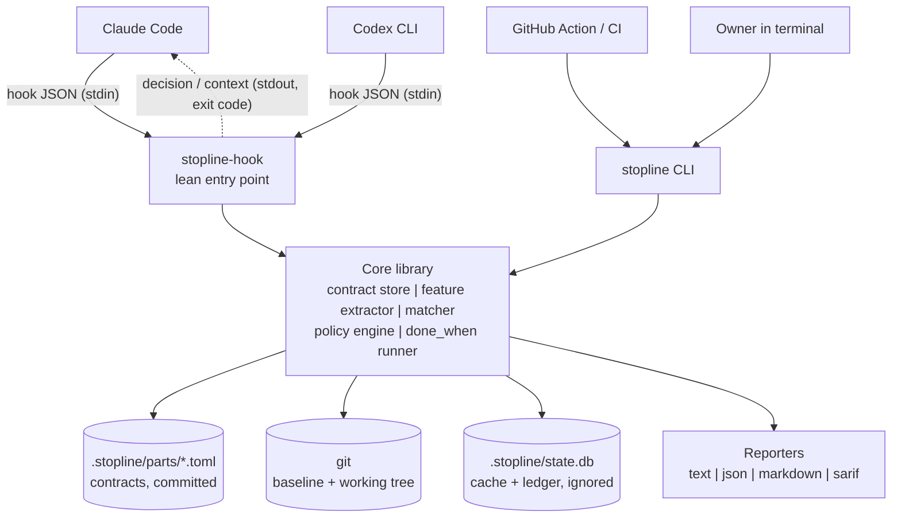
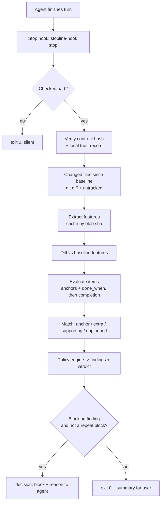
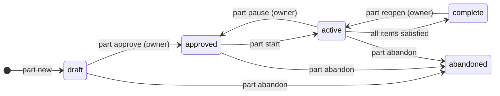
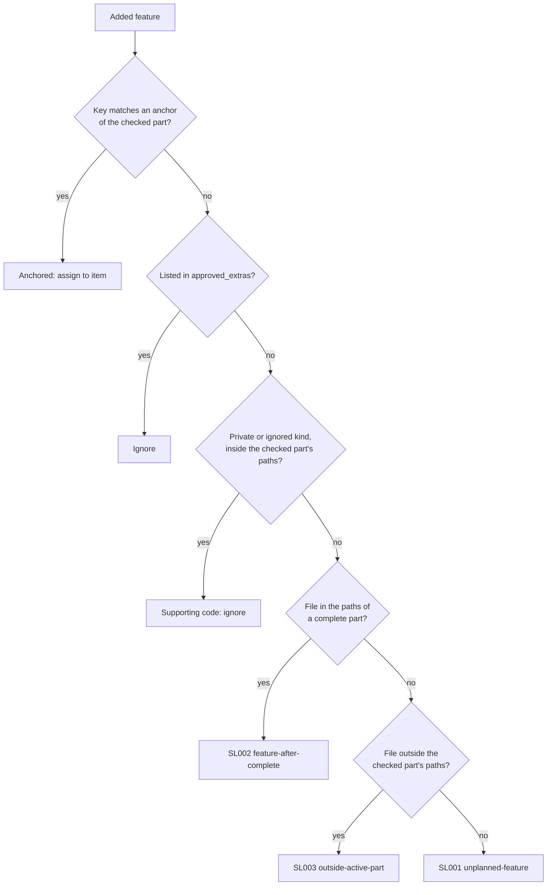
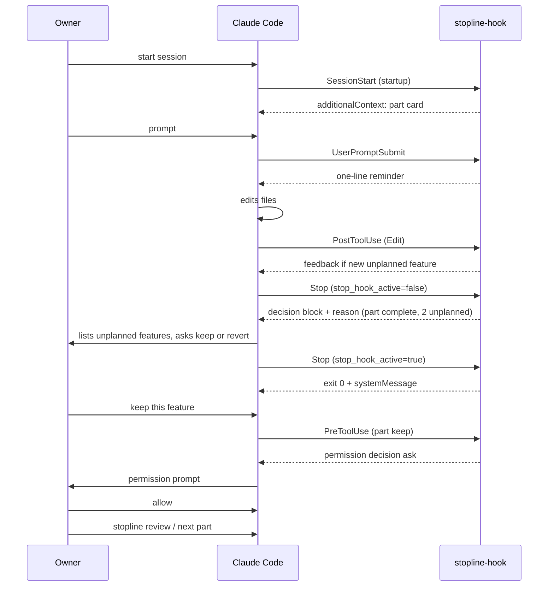

# Stopline

**Product and technical specification**  
A local guard that tells AI coding agents when a part of the architecture is finished, flags features nobody asked for, and keeps the work inside the plan.

| Field | Value |
|---|---|
| Document | Stopline product and technical specification |
| Version | 2.1 (4 Nov 2026, see Change log; supersedes v2.0 of 3 Nov 2026 and v1.0 of 1 Nov 2026) |
| Status | Ready for implementation. Section 26 decisions recorded 4 Nov 2026; Q5 still needs a budget figure. |
| Date | 3 November 2026 |
| Owner / author | Devansh Shah, Dwarkadas J. Sanghvi College of Engineering |
| Project type | Open-source developer tool (MIT licence) and college capstone |
| Audience | The coding agent that builds Stopline (Claude Code); maintainers; capstone reviewers |
| Change from v1.0 | Production scope: numbered requirements, full stack with versions, threat model, CLI and hook protocol, data model, CI/CD, release, governance, evaluation design. |

> **For the coding agent reading this:** this Markdown file is the living source of truth for the project. Diagrams referenced as Figure N are in stopline-diagrams.pdf; their Mermaid source is embedded next to each reference so you can update them. Read everything before writing code. Section 25 contains rules you must follow. Build one milestone at a time (section 23), stop at the end of each, and report with evidence. Do not build anything this document marks as out of scope.

## Contents

- [1. Executive summary](#1-executive-summary)
- [2. Problem statement](#2-problem-statement)
  - [2.1 The failure](#21-the-failure)
  - [2.2 Evidence](#22-evidence)
  - [2.3 Why existing approaches fall short](#23-why-existing-approaches-fall-short)
- [3. Competitive landscape and positioning](#3-competitive-landscape-and-positioning)
- [4. Goals, non-goals and success metrics](#4-goals-non-goals-and-success-metrics)
  - [4.1 Goals](#41-goals)
  - [4.2 Non-goals (v1)](#42-non-goals-v1)
  - [4.3 Success metrics](#43-success-metrics)
- [5. Users and use cases](#5-users-and-use-cases)
  - [5.1 Personas](#51-personas)
  - [5.2 User stories](#52-user-stories)
- [6. Concepts and glossary](#6-concepts-and-glossary)
- [7. System overview](#7-system-overview)
  - [7.1 Architecture](#71-architecture)
  - [7.2 What happens at the end of an agent turn](#72-what-happens-at-the-end-of-an-agent-turn)
- [8. Part lifecycle](#8-part-lifecycle)
- [9. Part contract specification](#9-part-contract-specification)
  - [9.1 Location and format](#91-location-and-format)
  - [9.2 Field reference](#92-field-reference)
  - [9.3 Validation and integrity](#93-validation-and-integrity)
- [10. Feature model and extraction](#10-feature-model-and-extraction)
  - [10.1 Feature record](#101-feature-record)
  - [10.2 Feature kinds by language](#102-feature-kinds-by-language)
  - [10.3 Extraction requirements](#103-extraction-requirements)
- [11. Matching and policy engine](#11-matching-and-policy-engine)
  - [11.1 Matching algorithm](#111-matching-algorithm)
  - [11.2 Item and part evaluation](#112-item-and-part-evaluation)
  - [11.3 Rule catalogue](#113-rule-catalogue)
  - [11.4 Verdict and loop protection](#114-verdict-and-loop-protection)
- [12. Agent integrations](#12-agent-integrations)
  - [12.1 Claude Code](#121-claude-code)
  - [12.2 Codex CLI](#122-codex-cli)
  - [12.3 CI and other agents](#123-ci-and-other-agents)
- [13. Command-line interface](#13-command-line-interface)
  - [13.1 Commands](#131-commands)
  - [13.2 Global options and conventions](#132-global-options-and-conventions)
  - [13.3 Exit codes](#133-exit-codes)
- [14. Configuration](#14-configuration)
  - [14.1 Environment variables](#141-environment-variables)
- [15. Data and storage](#15-data-and-storage)
  - [15.1 Repository files](#151-repository-files)
  - [15.2 state.db schema (v1)](#152-statedb-schema-v1)
  - [15.3 Report format (JSON)](#153-report-format-json)
- [16. Non-functional requirements](#16-non-functional-requirements)
- [17. Security, privacy and threat model](#17-security-privacy-and-threat-model)
  - [17.1 Assets](#171-assets)
  - [17.2 Threats and mitigations](#172-threats-and-mitigations)
  - [17.3 Owner-only operations](#173-owner-only-operations)
  - [17.4 Redaction](#174-redaction)
- [18. Technology stack](#18-technology-stack)
  - [18.1 Runtime](#181-runtime)
  - [18.2 Development and delivery](#182-development-and-delivery)
  - [18.3 Architecture decision records](#183-architecture-decision-records)
- [19. Repository layout and code conventions](#19-repository-layout-and-code-conventions)
  - [19.1 Conventions](#191-conventions)
- [20. Quality engineering](#20-quality-engineering)
  - [20.1 Test strategy](#201-test-strategy)
  - [20.2 CI/CD pipelines](#202-cicd-pipelines)
  - [20.3 Definition of done for every pull request](#203-definition-of-done-for-every-pull-request)
  - [20.4 Versioning, compatibility and support](#204-versioning-compatibility-and-support)
  - [20.5 Observability and support tooling](#205-observability-and-support-tooling)
- [21. Documentation and open-source governance](#21-documentation-and-open-source-governance)
  - [21.1 Documentation set](#211-documentation-set)
  - [21.2 Governance](#212-governance)
- [22. Evaluation plan (capstone evidence)](#22-evaluation-plan-capstone-evidence)
  - [22.1 Research questions](#221-research-questions)
  - [22.2 Design](#222-design)
  - [22.3 Metrics](#223-metrics)
- [23. Delivery plan](#23-delivery-plan)
  - [23.1 Milestones](#231-milestones)
  - [23.2 Release stages](#232-release-stages)
  - [23.3 Launch plan](#233-launch-plan)
- [24. Risks and mitigations](#24-risks-and-mitigations)
- [25. Rules for the coding agent building Stopline](#25-rules-for-the-coding-agent-building-stopline)
- [26. Open questions (owner decisions)](#26-open-questions-owner-decisions)
- [Appendix A. Example hook exchange (Claude Code Stop)](#appendix-a-example-hook-exchange-claude-code-stop)
  - [Appendix B. Example SessionStart part card](#appendix-b-example-sessionstart-part-card)
  - [Appendix C. Agent-drafted contract workflow](#appendix-c-agent-drafted-contract-workflow)
- [References](#references)
- [Change log](#change-log)

## 1. Executive summary

AI coding agents such as Claude Code and Codex do not know when a piece of work is finished. Asked to build one part of a system, they keep adding endpoints, options, screens and abstractions nobody requested. Instructions alone do not fix this: Claude Code's own system prompt already forbids it, and it still happens.

**Stopline** turns "what we agreed to build" into something a machine can check. Before an agent works on a part of the system, the owner approves a short **part contract** listing the features that part must have and how to verify each one. While the agent works, Stopline reads the code changes, extracts the **features** they add (routes, public functions, components, CLI options, config keys, dependencies) using tree-sitter, and matches each one to the contract. Anything that does not match is **unplanned** and is surfaced for the owner to keep or revert. When every contract item is satisfied, the part is **complete**; Stopline then blocks further feature additions to it and tells the agent to move on.

Stopline is a Python command-line tool with agent hooks for Claude Code and Codex, a Claude Code plugin, and a GitHub Action. It runs entirely on the developer's machine, makes no network calls and uses no language model in its decision path. Every part of the stack is free and open source.

|   | Summary |
|---|---|
| Problem | Agents overbuild inside the requested area (gold plating); owners lose track of what was added. |
| Solution | Owner-approved contracts + deterministic feature extraction + hooks that stop the agent when a part is done. |
| Differentiator | Feature-level, plan-aware checking. Existing tools check files, sizes, or false "done" claims. |
| Stack | Python 3.11-3.14, tree-sitter, msgspec, Typer/Rich, SQLite, git; uv, Ruff, mypy, pytest; GitHub Actions. |
| Delivery | 16 weeks, 9 milestones; public beta at week 12; v1.0 at week 16. |
| Success | Measured reduction in unplanned features per task with zero false blocks; adoption by external users. |

## 2. Problem statement

### 2.1 The failure

Given a task such as "build the auth module with login, logout and token refresh", a coding agent will often also add password reset, role guards, rate limiting, an admin endpoint and new configuration flags. Each addition looks helpful in isolation. Together they enlarge the diff, add untested surface, slow down review, and leave the owner with code they did not ask for and may not understand. In project-management terms this is **gold plating**: extra work originating from the team (here, the agent) inside the agreed scope, as opposed to *scope creep*, which originates from the client.

### 2.2 Evidence

- Claude Code's system prompt instructs the model not to add features, refactor, or make improvements beyond what was asked. A source-code study of eleven coding-agent harnesses found equivalent anti-gold-plating instructions in six of them and concluded that prompt text is a behavioral wish, not a mechanism [1].
- In an analysis of 15 agent-authored pull requests in the Kelos project, 6 were closed without merge; agents adding unrequested features was the leading pattern [2].
- Claude Code users report that mandatory "definition of done" rules written in CLAUDE.md are skipped [3].
- The project owner observed this directly: Claude Code kept extending one part of an architecture with features the owner did not know about and did not move on.

### 2.3 Why existing approaches fall short

- **Instructions** (system prompts, CLAUDE.md, skills) are advisory and fade in long sessions.
- **Code review** happens after the work is done, when reverting is expensive.
- **File-scope guards** cannot see new features added inside files the agent was allowed to edit.
- **Size thresholds** (lines or files changed) do not know what was planned.

## 3. Competitive landscape and positioning

Checked in November 2026. The coding-agent tooling space is crowded and moves weekly; repeat this check before launch.

| Tool | What it does | Gap relative to Stopline |
|---|---|---|
| define-done (jjailabs/skills) [4] | Written definition of done; Stop hook blocks false DONE claims. | Addresses stopping too early or claiming false completion, not overbuilding. |
| unasked [5], Overscope [6] | Flag edits to files outside the requested area; Overscope also flags deleted tests and new dependencies. | File/path level. Features added inside allowed files are invisible. |
| ScopeProof [7] | Flags module sprawl, changed-file growth and public API growth. | Closest. Uses thresholds rather than the owner's plan; symbol checks are Python only; no notion of a part being finished. |
| Scope Harisen [8], interactive-coding-agent [9] | Prompt and skill packs telling the agent to stay in scope. | Advisory only; same mechanism that already fails. |
| truth, claimcheck, Saidran | Check an agent's claims about its work against the diff and logs. | Different problem (honesty of reports). Complementary. |
| Claude Code /goal, Stop hooks | Primitives for completion conditions and end-of-turn checks. | Building blocks only; Stopline is built on them. |

> **Positioning statement.** For developers who build with AI coding agents, Stopline is the only tool that checks the agent's work against the owner's plan at the level of features, and tells the agent when a part is finished. Unlike prompt rules it is enforced by hooks; unlike file-scope guards it sees new features inside allowed files.

## 4. Goals, non-goals and success metrics

### 4.1 Goals

- **G1** Make the owner's plan for each part machine-checkable with minimal effort.
- **G2** Detect unplanned features deterministically, with very few false positives.
- **G3** Tell the agent clearly when a part is complete and stop further additions to it.
- **G4** Work with Claude Code and Codex, locally, offline, with negligible latency.
- **G5** Install in one command and be useful within five minutes.
- **G6** Produce published, reproducible evidence that it reduces overbuilding.

### 4.2 Non-goals (v1)

- Judging code quality, correctness or security (other tools do this).
- Verifying an agent's claims about tests or builds (truth, Saidran and similar tools do this).
- Automatically reverting code. Stopline identifies hunks; a human or the agent reverts.
- Using a language model to make blocking decisions.
- Hosted service, accounts, telemetry, or any network access.
- Languages other than Python, TypeScript and JavaScript.
- Graphical user interfaces (web dashboard, IDE extension) - roadmap only.

### 4.3 Success metrics

| Metric | Target | Measured by |
|---|---|---|
| Unplanned features per task (with vs without Stopline) | Reduction of at least 50% | Evaluation, section 22 |
| False block rate (blocks on runs that followed the plan) | 0 in evaluation; under 1% in beta reports | Evaluation + beta issue reports |
| Unplanned-feature precision | At least 90% | Evaluation labels |
| Feature extraction recall | At least 90% on supported kinds | Golden corpus + evaluation |
| Stop hook latency, p95 | Under 1.5 s (excluding done_when commands) | Benchmark in CI |
| Time to first value | Under 5 minutes from install | Usability test with 5 developers |
| Adoption (3 months after v1.0) | 500 PyPI downloads/month; 10 external issues or PRs | pypistats, GitHub |

## 5. Users and use cases

### 5.1 Personas

| Persona | Context | Needs |
|---|---|---|
| Solo builder (primary) | Student or indie developer building an app with Claude Code or Codex for hours at a time. | Keep the agent on plan; know what was added; move through parts in order. |
| Team lead | Small team where several people run agents on a shared repo. | Committed contracts as shared scope; CI check on pull requests. |
| OSS maintainer | Receives agent-written pull requests from contributors. | See unplanned surface in a PR at a glance (SARIF annotations, PR summary). |

### 5.2 User stories

| ID | Story | Priority |
|---|---|---|
| US-01 | As a builder, I can describe a part and have the agent draft its contract, then approve it with one command. | Must |
| US-02 | As a builder, I am told at the end of each agent turn which features were added that are not in the contract. | Must |
| US-03 | As a builder, when every item of a part is done, the agent is told the part is complete and stops adding to it. | Must |
| US-04 | As a builder, I can keep an unplanned feature (recorded as an approved extra) or get the exact hunks to revert it. | Must |
| US-05 | As a builder, after context compaction the agent is reminded of the active part and remaining items. | Must |
| US-06 | As a builder, I can see the status of all parts in one command. | Must |
| US-07 | As a team lead, I can run Stopline in CI and fail a pull request that adds features to a completed part. | Should |
| US-08 | As a Codex user, I get the same checks as a Claude Code user. | Should |
| US-09 | As a maintainer, unplanned features appear as annotations on the pull request diff. | Should |
| US-10 | As a contributor, I can add support for a new framework by adding query files only. | Should |
| US-11 | As a builder, I can run Stopline in observe-only mode before trusting it to block. | Must |
| US-12 | As a builder, I can disable Stopline instantly for one session. | Must |

## 6. Concepts and glossary

| Term | Definition |
|---|---|
| Part | A named piece of the architecture with a bounded set of features, e.g. auth, billing, search-ui. Owns a set of path globs. |
| Part contract | A TOML file listing a part's items, the features each item should introduce (anchors), and how to verify each item (done_when). Approved by the owner. |
| Item | One planned capability within a part, e.g. "login returns tokens". |
| Anchor | A feature-key pattern naming the feature(s) an item is expected to introduce, e.g. `route:POST /auth/login`. |
| Feature | A unit of new public surface found in code: route, page, function, method, class, component, CLI command or option, config key, data table, dependency. |
| Feature key | Canonical identifier of a feature: `kind:name`, e.g. `function:auth.service.login`. |
| Baseline | The git commit recorded when a part was started. Features are computed relative to it. |
| Unplanned feature | A feature added since the baseline that matches no anchor, approved extra or supporting-code rule. |
| Approved extra | An unplanned feature the owner chose to keep; recorded in the contract. |
| Supporting code | Private helpers and internal symbols that implement items; not features by default. |
| Active part | The single part currently being worked on in a worktree. |
| Checked part | The part that checks run against: the active part, or the most recently completed part when no part is active in the worktree. |
| Trust record | A local entry in state.db (not in git) holding a contract's approval hash, status and baseline as this clone last accepted them. Without a matching record, done_when never runs. |
| Complete (frozen) | All items satisfied. New features in the part's paths are blocked until the owner reopens it. |
| Finding | A rule violation produced by the policy engine, with a rule ID (SL001...), severity and location. |
| Mode | observe (report only), warn (feedback to agent, never block), enforce (block on blocking findings). |

## 7. System overview

### 7.1 Architecture

> **Figure 1. Components. Everything inside Stopline runs locally; there is no server and no network access.** - see `stopline-diagrams.pdf`, page 2. Mermaid source (keep in sync if you change the design):



| Component | Responsibility |
|---|---|
| `stopline-hook` | Lean executable invoked by agent hooks. Reads hook JSON from stdin, runs the matching check, writes the agent-specific response. Imports only what the event needs. |
| `stopline` CLI | Owner-facing commands (contracts, status, review, check, hooks, doctor) and CI entry point. |
| Contract store | Loads, validates, writes and integrity-checks part contracts; manages part state. |
| Feature extractor | Parses source files with tree-sitter and returns features via per-language query files. Error-tolerant. |
| Baseline service | Resolves the baseline commit, lists changed and untracked files, reads baseline file contents via git. |
| Matcher | Classifies each added feature as anchored, approved extra, supporting, or unplanned. |
| Policy engine | Evaluates rules SL001-SL009, item status, part completion and the overall verdict for the current mode. |
| done_when runner | Runs owner-approved verification commands with timeouts; caches results by tree hash. |
| State store | SQLite database for feature cache, check ledger, block history and part state metadata. |
| Reporters | Render results as terminal text, JSON, Markdown and SARIF 2.1.0. |
| Agent adapters | Translate between each agent's hook protocol and the core (Claude Code, Codex). |

### 7.2 What happens at the end of an agent turn

1. The agent finishes its turn; its Stop hook invokes `stopline-hook stop --agent claude`.
2. If Stopline is disabled, or this worktree has no checked part, exit 0 silently.
3. Verify the checked part's contract: the approval hash, and that status and baseline match the local trust record (FR-CON-03, FR-CON-08). A mismatch, or a missing trust record, produces finding SL004; done_when is not run and the part cannot complete.
4. List files changed since the baseline (`git diff --name-status` plus untracked, non-ignored files), filtered by include/exclude and secret deny-lists.
5. Extract features for each changed file in the working tree and at the baseline, using the cache keyed by git blob hash.
6. Diff the two feature sets into added, removed and changed features.
7. Evaluate items: anchors present in the working-tree features, then done_when (only if the tree changed since the last passing run).
8. If all items are satisfied, transition the part to complete (recording the tree hash). This happens before matching, so features added in the same turn are judged against the completed part (SL002).
9. Match added features against anchors, approved extras and supporting-code rules.
10. The policy engine produces findings and a verdict; check the block history to avoid repeat blocks.
11. Return either a block decision with an actionable reason, or exit 0 with a one-line summary for the user. Record everything in the ledger.

> **Figure 3. End-of-turn check flow** - see `stopline-diagrams.pdf`, page 4. Mermaid source (keep in sync if you change the design):



## 8. Part lifecycle

> **Figure 2. Part states and transitions.** - see `stopline-diagrams.pdf`, page 3. Mermaid source (keep in sync if you change the design):



| From | To | Trigger | Rules |
|---|---|---|---|
| (none) | draft | `part new NAME` | Creates TOML from template or from `--from FILE` (agent-drafted). |
| draft | approved | `part approve NAME` | Owner only: requires an interactive terminal (see 17.3). Validates contract; records approval hash, approver (git user.name) and time. Also re-signs an edited contract of an approved, active or complete part without changing its status (FR-LC-06). |
| approved | active | `part start NAME` | At most one active part per worktree. Records baseline = HEAD on the first start only; starting again after a pause keeps the original baseline. Refuses if the working tree has uncommitted changes in the part's paths unless `--allow-dirty`. |
| active | approved | `part pause` | Owner only (TTY), so an agent cannot switch off its own checks. Keeps baseline; no checks run while paused. |
| active | complete | Automatic | All items satisfied at a check. Records completion tree hash and time. |
| complete | active | `part reopen NAME` | Owner only (TTY). Optionally adds items; requires re-approval if items changed. |
| any but complete | abandoned | `part abandon NAME` | Owner only. Kept for history. |

Requirements:

| ID | Requirement | Pri. |
|---|---|---|
| FR-LC-01 | The system shall persist part state in the contract file (`status`, committed and shared) and keep a local trust record in state.db (FR-CON-08) that is compared with it. | Must |
| FR-LC-02 | The system shall allow at most one active part per git worktree. | Must |
| FR-LC-03 | Transitions marked owner-only shall refuse to run without an interactive terminal unless `STOPLINE_ALLOW_NONINTERACTIVE=1` is set in the environment by the owner. | Must |
| FR-LC-04 | Completion shall be automatic and idempotent; a completed part shall stay complete until reopened even if a later check fails (that failure is reported as SL008). | Must |
| FR-LC-05 | A completed part shall remain the checked part, so its paths stay protected, until another part is started. After another part starts, features added in the completed part's paths are still reported as SL002 (section 11.1). | Must |
| FR-LC-06 | `part approve` shall also accept a part in approved, active or complete status whose contract was edited (including a reopened part with changed items). It re-signs the approval hash and leaves status and baseline unchanged. | Must |

## 9. Part contract specification

### 9.1 Location and format

One file per part: `.stopline/parts/<id>.toml`. TOML 1.0, UTF-8, committed to git. A JSON Schema is published at `src/stopline/schemas/contract.v1.schema.json` and referenced with a `#:schema` comment so editors (Taplo, VS Code Even Better TOML) validate as you type.

```toml
#:schema https://raw.githubusercontent.com/Webs4Dev/stopline/main/src/stopline/schemas/contract.v1.schema.json
schema  = 1
id      = "auth"                       # [a-z0-9-], unique, equals file name
title   = "Authentication"
summary = "Email + password login with JWT access and refresh tokens"
paths   = ["src/auth/**", "tests/auth/**"]
status  = "approved"                   # draft|approved|active|complete|abandoned

[approval]                             # written by `part approve`, never by hand
hash        = "sha256:9f2c...e41a"     # canonical hash of summary+paths+items+extras+allow_overlap
approved_by = "Devansh Shah"
approved_at = 2026-11-10T09:12:00Z

[baseline]                             # written by `part start`
commit     = "a1b2c3d4e5f6"
started_at = 2026-11-10T09:15:00Z

[[items]]
id        = "login"
desc      = "POST /auth/login returns access and refresh tokens"
anchors   = ["route:POST /auth/login"]
done_when = ["uv", "run", "pytest", "tests/auth/test_login.py", "-q"]

[[items]]
id        = "logout"
desc      = "POST /auth/logout revokes the refresh token"
anchors   = ["route:POST /auth/logout"]
done_when = ["uv", "run", "pytest", "tests/auth/test_logout.py", "-q"]

[[items]]
id        = "refresh"
desc      = "POST /auth/refresh issues a new access token"
anchors   = ["route:POST /auth/refresh", "function:auth.tokens.issue_*"]
done_when = { cmd = "pytest tests/auth/test_refresh.py -q && ruff check src/auth", shell = true, timeout_s = 120 }

[[approved_extras]]
feature     = "function:auth.passwords.hash_password"
reason      = "Helper required by login"
approved_at = 2026-11-10T11:40:00Z
```

### 9.2 Field reference

| Field | Type | Rules |
|---|---|---|
| `schema` | int | Required. Contract schema version; currently 1. |
| `id` | string | Required. `^[a-z0-9][a-z0-9-]{0,47}$`; must equal the file stem. |
| `title, summary` | string | Required. Summary at most 300 characters. |
| `paths` | string[] | Required, 1-20 entries. Gitignore-style globs relative to the repo root. Paths of two non-abandoned parts may overlap only if `allow_overlap = true` on both. |
| `status` | enum | Managed by Stopline; manual edits are detected and rejected. |
| `items` | table[] | Required, 1-12 entries (3-7 recommended). Item `id` unique within the part. |
| `items.anchors` | string[] | 0-10 feature-key patterns. Glob wildcards `*` and `?` allowed in the name portion only. |
| `items.done_when` | argv list or table | Optional. List form runs without a shell. Table form `{cmd, shell, timeout_s, cwd}`; `shell = true` must be explicit. Default timeout 120 s, max 900 s. |
| `approved_extras` | table[] | Feature key, reason (required), timestamp. |
| `approval, baseline` | table | Written only by Stopline commands. |

### 9.3 Validation and integrity

| ID | Requirement | Pri. |
|---|---|---|
| FR-CON-01 | Contracts shall be validated against the schema on load; errors shall name the file, line and field and suggest a fix. | Must |
| FR-CON-02 | The approval hash shall be SHA-256 over a canonical JSON serialisation (sorted keys, no whitespace between JSON elements) of summary, paths, items, approved_extras and allow_overlap. Text inside values is hashed exactly as written and is never normalised. | Must |
| FR-CON-03 | If the current content hash differs from the approval hash, the contract is treated as unapproved: finding SL004 (blocking in enforce mode) and no completion. | Must |
| FR-CON-04 | `part keep FEATURE` shall append an approved extra and re-sign the approval hash in one step. It needs no terminal, so an agent can run it, but the owner must allow each run in the agent's own permission prompt (12.1, 17.3). | Must |
| FR-CON-05 | `part new --from FILE` shall accept an agent-drafted contract (TOML or JSON) and save it as draft without approving it. | Must |
| FR-CON-06 | A warning shall be emitted when an item has neither anchors nor done_when (it can never be verified). Such an item is never satisfied, so the part cannot complete until the owner adds an anchor or a done_when. | Must |
| FR-CON-07 | Writes shall be atomic (temp file + rename) and preserve comments outside Stopline-managed tables. | Should |
| FR-CON-08 | Stopline shall keep a local trust record per part in state.db: approval hash, status, baseline commit, who and when. If the contract file's approval hash, status or baseline differs from the record and no Stopline command wrote the change, or no record exists (fresh clone, rebuilt database, branch merged from elsewhere), the part is untrusted: finding SL004, done_when is not run, and the part cannot complete. The approval hash covers only summary, paths, items, approved_extras and allow_overlap (FR-CON-02), so status and baseline are protected by this record instead. | Must |
| FR-CON-09 | `stopline trust [ID...]` (owner, TTY) shall show every done_when command the contract would be allowed to run, then accept the current committed contract (hash, status, baseline) as the local record. `part approve` also creates or replaces the record. Every other Stopline command that changes a contract (`part start`, `keep`, `pause`, ...) first requires a record matching the file and refuses without one, then updates it, so an agent cannot make a contract trusted by running a command it is allowed to run. | Must |

## 10. Feature model and extraction

### 10.1 Feature record

```text
Feature {
  key:        "route:POST /auth/login"     # kind:name, canonical
  kind:       "route"
  name:       "POST /auth/login"
  symbol:     "auth.routes.login"          # qualified symbol when applicable
  file:       "src/auth/routes.py"
  line:       14                           # 1-based start line
  end_line:   31
  signature:  "login(body: LoginIn) -> TokenOut"   # normalised, for change detection
  visibility: "public" | "private"
  language:   "python" | "typescript" | "tsx" | "javascript" | "jsx" | "manifest"
  confidence: "exact" | "heuristic"        # heuristic = framework pattern inferred
}
```

### 10.2 Feature kinds by language

| Kind | Python | TypeScript / JavaScript | Phase |
|---|---|---|---|
| route | FastAPI/Starlette decorators (`@app.get`, `@router.post`), Flask `@app.route` with methods, Django `path()`/`re_path()` in urls.py | Express/Hono/Fastify `app.METHOD(path)`, Next.js `app/**/route.ts` exported GET/POST/... | v1.0 |
| page | - | Next.js `app/**/page.tsx`, `pages/**`; React Router route objects (heuristic) | v1.0 |
| function | Public module-level functions | Exported functions and exported const arrow functions | v1.0 |
| method | Public methods of public classes | Public methods of exported classes | v1.0 |
| class | Public classes | Exported classes and interfaces | v1.0 |
| component | - | Exported PascalCase functions/consts in .tsx/.jsx whose body contains JSX | v1.0 |
| cli | argparse `add_argument`/`add_parser`, Click and Typer commands and options | commander and yargs commands and options | v1.0 |
| config | `os.environ[..]`, `os.getenv`, `environ.get`; pydantic-settings fields | `process.env.X`, `import.meta.env.X` | v1.0 |
| dependency | `pyproject.toml` project and optional deps; `requirements*.txt` | `package.json` dependencies (devDependencies as `dependency:dev:NAME`) | v1.0 |
| table | SQLAlchemy models with `__tablename__`; Django `models.Model` subclasses; Alembic migrations | Prisma `model X`; Drizzle `pgTable/sqliteTable` | v1.1 |

### 10.3 Extraction requirements

| ID | Requirement | Pri. |
|---|---|---|
| FR-EX-01 | Extraction shall use tree-sitter with one `.scm` query file per language and kind under `stopline/queries/<lang>/<kind>.scm`. Supporting a new framework shall require only new query files plus a small post-processor if needed. | Must |
| FR-EX-02 | Visibility: Python names without a leading underscore, filtered by `__all__` when defined; TS/JS exported symbols only. | Must |
| FR-EX-03 | Extraction shall be error-tolerant: files with syntax errors are still parsed (tree-sitter recovers); if the root has errors covering more than 30% of bytes, the file is reported as SL005 (unparseable) instead of guessed. | Must |
| FR-EX-04 | Route names shall be normalised: upper-case method, single space, path as written. Router prefixes (`APIRouter(prefix=...)`, `app.use('/api', r)`) resolved when in the same file; otherwise `confidence = heuristic`. | Must |
| FR-EX-05 | Change classification: a feature present in both sets with a different normalised signature is `changed`; changed features are reported but never unplanned. | Must |
| FR-EX-06 | Manifest files (pyproject.toml, requirements*.txt, package.json) shall be parsed with standard TOML/JSON parsers, not tree-sitter. | Must |
| FR-EX-07 | Files larger than `limits.max_file_kb` (default 512 KB), binary files, generated and vendored paths, and secret deny-list matches shall be skipped and counted. | Must |
| FR-EX-08 | Results shall be cached in state.db keyed by (git blob SHA, extractor version, query-set hash). | Must |
| FR-EX-09 | A golden corpus of at least 150 annotated snippets per language shall gate every change to queries. | Must |

## 11. Matching and policy engine

### 11.1 Matching algorithm

For each *added* feature, in order (first match wins):

1. **Anchored**: key matches an anchor of an item in the checked part (exact, then glob). Assigned to that item.
2. **Approved extra**: key equals an entry in `approved_extras`. Ignored.
3. **Supporting**: visibility is private, or kind is in `supporting.ignore_kinds`, and the file lies inside the checked part's paths. Ignored.
4. **Completed part**: file lies in the paths of any complete part (the checked part or another one). Reported as SL002.
5. **Outside**: file lies outside the checked part's paths, whether in another part's paths or in no part at all. Reported as SL003.
6. **Unplanned**: everything else, which means the file is inside the checked part's paths and the part is not complete. Reported as SL001.

Matching is purely deterministic. An optional suggestion engine (roadmap) may propose which item an unplanned feature belongs to, but it can only suggest; it never changes a verdict.

> **Figure 4. Feature matching decision** - see `stopline-diagrams.pdf`, page 5. Mermaid source (keep in sync if you change the design):



### 11.2 Item and part evaluation

- An item is **satisfied** when every anchor pattern matches at least one feature present in the working tree, and its done_when (if any) exits 0. An item with neither anchors nor done_when is never satisfied.
- done_when runs only during full checks (Stop hook, `stopline check`), never in PostToolUse; results are cached by working-tree hash, so an unchanged tree never re-runs commands.
- done_when output is captured, truncated to the last 40 lines, redacted (17.4), and stored; only exit code and duration are shown to the agent.
- A part is complete when all items are satisfied and no SL004 exists.

### 11.3 Rule catalogue

| Rule | Name | Trigger | observe | warn | enforce |
|---|---|---|---|---|---|
| SL001 | unplanned-feature | Added feature in the checked part's paths matches nothing (part not complete) | info | warn | warn* |
| SL002 | feature-after-complete | Added feature in the paths of a complete part | info | warn | block |
| SL003 | outside-active-part | Added feature outside the checked part's paths (and not in a complete part's paths) | info | warn | warn |
| SL004 | contract-tampered | Contract content differs from approval hash, or status/baseline differ from the local trust record, or no trust record exists | warn | warn | block |
| SL005 | unparseable-file | Changed file could not be parsed reliably | info | info | info |
| SL006 | item-check-failed | done_when exited non-zero or timed out | info | info | info |
| SL007 | undisclosed-unplanned | Unplanned features exist and the agent's final message does not name them | info | warn | block |
| SL008 | regression-after-complete | Anchor of a completed item disappeared or its done_when now fails | warn | warn | block |
| SL009 | anchor-renamed | Anchored feature removed and a near-identical feature added (possible gaming) | info | warn | warn |

\* In enforce mode SL001 escalates to block once the count of unplanned features in the part exceeds `policy.max_unplanned` (default 3) without owner review. SL007 means the agent may keep going as long as it tells the owner what it added; this keeps the owner informed without making every helpful extra a hard stop.

### 11.4 Verdict and loop protection

| ID | Requirement | Pri. |
|---|---|---|
| FR-PE-01 | Verdict = block if any finding has severity block in the current mode; warn if any warn; else pass. | Must |
| FR-PE-02 | A block fingerprint (sorted rule IDs and feature keys) shall be stored per session. If the agent stops again with `stop_hook_active = true` and an identical fingerprint, Stopline shall not block again; it emits a user-visible `systemMessage` instead. | Must |
| FR-PE-03 | No more than 3 blocks per session per fingerprint family; then downgrade to warn and tell the user. (Claude Code also ends the turn itself after repeated consecutive blocks [10].) | Must |
| FR-PE-04 | Every check shall be appended to the ledger: timestamp, session, event, part, verdict, findings, durations. | Must |

## 12. Agent integrations

> Hook protocols change between agent releases. Before implementing an adapter, read the current official documentation (Claude Code: code.claude.com/docs/en/hooks; Codex: developers.openai.com/codex/hooks) and record the tested versions in docs/compatibility.md. Field names below were verified on 3 Nov 2026 [10][11].

### 12.1 Claude Code

| Event (matcher) | Stopline behaviour | Output | Budget |
|---|---|---|---|
| SessionStart (startup, resume, compact, clear) | If a part is active, print the part card: id, summary, items with status, unplanned count, and the rule "build only these items; when all are done, stop and ask". On `compact` this restores the plan after compaction. | `hookSpecificOutput.additionalContext` (max 1,500 chars) | p95 300 ms |
| UserPromptSubmit | One line: active part and remaining items. Silent when no part is active. | `additionalContext` | p95 150 ms |
| PreToolUse (Edit\|Write\|MultiEdit, Bash) | Deny edits to `.stopline/**` and Bash commands invoking owner-only subcommands (`part approve\|pause\|reopen\|abandon`, `trust`, `review`, `hooks uninstall`). Bash commands invoking `part keep` get `ask`, so Claude Code shows the owner its own permission prompt. | permission decision deny or ask + reason | p95 100 ms |
| PostToolUse (Edit\|Write\|MultiEdit) | Incremental check of the edited file only. On a new unplanned feature, return feedback; never block. | `additionalContext` | p95 300 ms |
| Stop | Full check (section 7.2). Block only on blocking findings with loop protection. | `decision: block` + reason, or exit 0 + `systemMessage` | p95 1.5 s + done_when |

#### Example Stop block reason (sent to the agent)

```text
Stopline: part 'auth' is COMPLETE (3/3 items verified). You added 2 features
that are not in the plan:
  - function auth.reset.send_reset_email   src/auth/reset.py:12
  - route    POST /admin/roles             src/auth/routes.py:88
Do not add more to 'auth'. In your reply, list these 2 features for the owner
and ask whether to keep or revert them. Then stop and ask which part is next.
```

#### Packaging for Claude Code

- **Plugin** (recommended): the repository is also a Claude Code plugin marketplace (`.claude-plugin/marketplace.json`). The plugin ships `hooks/hooks.json` calling `stopline-hook`, and a skill `skills/stopline/SKILL.md` that teaches the agent the workflow: draft a contract with `part new --from`, ask the owner to approve, build only contract items, disclose unplanned features, and run `part keep` when the owner says to keep one. If the `stopline-hook` binary is missing, the SessionStart hook prints install instructions and every other hook exits 0.
- **Direct**: `stopline hooks install --agent claude --scope project|local|user` merges entries into the matching settings file, marks them with a `stopline` identifier, backs up the original, writes atomically, and is idempotent. `hooks uninstall` removes only its own entries.
- Hook commands use exec form (`command` + `args`) so paths with spaces work on all platforms.

> **Figure 5. Hook interaction across one session (Claude Code)** - see `stopline-diagrams.pdf`, page 6. Mermaid source (keep in sync if you change the design):



### 12.2 Codex CLI

| Event | Behaviour |
|---|---|
| SessionStart | Same part card as Claude Code. |
| UserPromptSubmit | Same one-line reminder. |
| PreToolUse (Bash) | Deny owner-only Stopline subcommands, and also `part keep`: no way to show a permission prompt from a Codex hook has been verified, so the owner runs it. Verify before M6. |
| Stop | Full check; `{"decision":"block","reason":...}`; honours `stop_hook_active` and reads `last_assistant_message`. |

Codex hooks are configured in `~/.codex/hooks.json` or `.codex/hooks.json`. At the time of writing, Codex reports tool hooks for shell commands, so file edits may not trigger PostToolUse; Stopline therefore relies on the Stop check for Codex, which diffs the working tree directly and does not depend on edit events [11]. Verify current behaviour before M6.

### 12.3 CI and other agents

- `stopline check --base REF --format sarif|json|markdown` works without any agent: CI, pre-commit, or manual use.
- **GitHub Action** `Webs4Dev/stopline-action` (composite): installs with uv, runs `stopline trust --base REF` (trusts only contracts unchanged from the base ref, so a pull request cannot get its own done_when commands run), runs check against the PR base, uploads SARIF to code scanning (free for public repositories), writes a job summary, optionally comments on the PR.
- **pre-commit hook** definition in `.pre-commit-hooks.yaml` (Should).

## 13. Command-line interface

### 13.1 Commands

| Command | Purpose | Owner-only |
|---|---|---|
| `stopline init [--agent claude\|codex\|both] [--scope ...]` | Create .stopline/, config, .gitignore entries; offer to install hooks. | no |
| `stopline part new ID [--from FILE]` | Create a draft contract (template or agent draft). | no |
| `stopline part show ID` | Print a contract with item status. | no |
| `stopline part approve ID` | Validate and sign a draft or edited contract. | yes |
| `stopline part start ID` | Make a part active and record the baseline. | no |
| `stopline part pause \| reopen ID \| abandon ID` | Lifecycle transitions. | pause, reopen, abandon |
| `stopline part keep FEATURE [--part ID] [--reason TEXT]` | Add an approved extra and re-sign. Without `--part` it applies to the active part. Without `--reason`, a terminal prompts for one and anything else is an error. | no terminal needed, but agents go through the permission prompt (12.1) |
| `stopline part list` | All parts with status and counts. | no |
| `stopline trust [ID...] [--base REF]` | Accept committed contracts as trusted in this clone (fresh clone, rebuilt database, merged branch); shows the done_when commands first. With `--base REF`, trust only contracts unchanged from REF (used by CI). | yes |
| `stopline status` | Active part, items, unplanned features, last check. | no |
| `stopline review` | Interactive keep / revert / skip for each unplanned feature; revert prints the exact hunks (`git diff` excerpt). | yes |
| `stopline check [--base REF] [--part ID] [--format F]` | Full check; CI entry point. | no |
| `stopline features [PATH...]` | Print extracted features (debugging, contract authoring). | no |
| `stopline hooks install \| uninstall \| status` | Manage agent hooks. | uninstall |
| `stopline log [--session ID] [--last N]` | Show the check ledger. | no |
| `stopline doctor` | Diagnose git, hooks, grammars, config, permissions, versions. | no |
| `stopline schema contract\|report` | Print JSON Schemas. | no |

### 13.2 Global options and conventions

- `--format text|json|markdown|sarif` (where applicable), `--quiet`, `--verbose`, `--no-color`, `--repo PATH`, `--version`.
- Respects `NO_COLOR` and non-TTY output (no colour, no spinners). Never conveys meaning by colour alone.
- JSON output carries `schema_version` and is stable within a major version.
- Every error message states what went wrong, why, and the command to fix it.

### 13.3 Exit codes

| Code | Meaning |
|---|---|
| 0 | Success; no findings at warn level or above. |
| 1 | Findings at warn level (check). |
| 2 | Blocking findings (check). |
| 3 | Contract or configuration error. |
| 4 | Usage error (bad arguments). |
| 5 | Environment error (not a git repository, git missing). |
| 70 | Internal error (bug). Message includes how to report it. |

`stopline-hook` follows each agent's hook protocol instead (exit 0 or 2 plus JSON) and **fails open**: any internal error results in exit 0 and a short warning.

## 14. Configuration

`.stopline/config.toml` (committed). Every key is optional; defaults shown.

```toml
mode = "warn"                       # observe | warn | enforce

[scan]
languages = ["python", "typescript", "javascript"]
include   = ["**/*"]                # gitignore-style
exclude   = ["**/node_modules/**", "**/.venv/**", "**/dist/**", "**/build/**",
             "**/vendor/**", "**/*.min.js", "**/migrations/versions/**"]
respect_gitignore = true

[secrets]                           # never read; added to built-in list
deny = [".env", ".env.*", "*.pem", "*.key", "id_rsa*", "id_ed25519*",
        "client_secret*.json", "token*.json", "credentials*", "*.p12", "*.pfx"]

[supporting]
private_helpers = true              # private symbols inside part paths are not features
ignore_kinds    = []                # e.g. ["method"]

[policy]
max_unplanned       = 3             # SL001 escalates to block above this (enforce)
require_disclosure  = true          # SL007
block_limit_per_session = 3

[done_when]
default_timeout_s = 120
max_parallel      = 2

[limits]
max_file_kb       = 512
hook_budget_ms    = 1500            # exceed -> warning in ledger, never a failure
```

### 14.1 Environment variables

| Variable | Effect |
|---|---|
| `STOPLINE_DISABLE=1` | All hooks exit 0 immediately (per-session kill switch). |
| `STOPLINE_MODE` | Override mode for this process. |
| `STOPLINE_ALLOW_NONINTERACTIVE=1` | Permit owner-only commands without a TTY (CI and scripts set by the owner). |
| `STOPLINE_DEBUG=1` | Write redacted hook payloads and timings to `.stopline/logs/debug.jsonl`. |
| `STOPLINE_HOME` | Override user-level data directory. |

## 15. Data and storage

### 15.1 Repository files

```text
.stopline/
  config.toml          committed   project configuration
  parts/*.toml         committed   part contracts
  .gitignore           committed   ignores everything below
  state.db             ignored     SQLite: cache, ledger, block history, part index
  logs/                ignored     debug logs (only when STOPLINE_DEBUG=1)
  runs/                ignored     done_when output (truncated, redacted)
```

### 15.2 state.db schema (v1)

```sql
meta(key TEXT PRIMARY KEY, value TEXT)                 -- schema_version, created_at
feature_cache(blob_sha TEXT, extractor TEXT, queries TEXT, path TEXT,
              features BLOB,  -- msgspec-encoded list[Feature]
              last_used TEXT, -- updated on a cache hit at most once a day
              PRIMARY KEY (blob_sha, extractor, queries))
part_index(part_id TEXT PRIMARY KEY, status TEXT, baseline TEXT,
           approval_hash TEXT, completed_tree TEXT, updated_at TEXT)
check_ledger(id INTEGER PRIMARY KEY, ts TEXT, session TEXT, agent TEXT,
             event TEXT, part_id TEXT, verdict TEXT, findings TEXT,  -- JSON
             duration_ms INTEGER, tree_hash TEXT)
item_runs(part_id TEXT, item_id TEXT, tree_hash TEXT, exit_code INTEGER,
          duration_ms INTEGER, ts TEXT, PRIMARY KEY (part_id, item_id, tree_hash))
block_history(session TEXT, fingerprint TEXT, count INTEGER, last_ts TEXT,
              PRIMARY KEY (session, fingerprint))
trust(part_id TEXT PRIMARY KEY, approval_hash TEXT, status TEXT, baseline TEXT,
      trusted_by TEXT, trusted_at TEXT)                -- local trust record (FR-CON-08)
```

- WAL mode, `busy_timeout = 2000` ms; safe for concurrent hook processes.
- Migrations are forward-only, numbered, applied on open. A corrupt or incompatible database is renamed aside and rebuilt (it holds derived data, history and trust records). After a rebuild every part is untrusted until the owner runs `stopline trust` (FR-CON-08).
- Cache eviction: entries whose `last_used` is more than 30 days old, then the least recently used entries while the total size of `features` is over 200 MB.
- The working-tree hash is `git write-tree` on a temporary index including untracked files but excluding `.stopline/`, so it is exact and cheap and Stopline's own writes never change it.

### 15.3 Report format (JSON)

```json
{
  "schema_version": 1,
  "tool": {"name": "stopline", "version": "1.0.0"},
  "generated_at": "2026-11-10T12:00:00Z",
  "mode": "enforce",
  "verdict": "block",
  "part": {"id": "auth", "status": "complete", "baseline": "a1b2c3d",
           "items": [{"id": "login", "satisfied": true,
                      "anchors": [{"pattern": "route:POST /auth/login", "matched": true}],
                      "done_when": {"exit_code": 0, "duration_ms": 2140, "cached": true}}]},
  "features": {"added": 7, "removed": 0, "changed": 2},
  "findings": [{"rule": "SL002", "severity": "block",
                "feature": "route:POST /admin/roles",
                "location": {"file": "src/auth/routes.py", "line": 88},
                "message": "Feature added to completed part 'auth'."}],
  "timings_ms": {"git": 41, "extract": 212, "match": 3, "done_when": 0}
}
```

## 16. Non-functional requirements

| ID | Category | Requirement | Verification |
|---|---|---|---|
| NFR-01 | Performance | Stop hook p95 under 1.5 s and p99 under 3 s, excluding done_when, on a 5,000-file repo with 50 changed files (warm cache). | Benchmark job in CI |
| NFR-02 | Performance | PostToolUse and SessionStart p95 under 300 ms; process cold start under 150 ms (measured 100-135 ms in a prototype on 3 Nov 2026). | Benchmark job |
| NFR-03 | Performance | Cold cache full check of 50 changed files under 4 s. | Benchmark job |
| NFR-04 | Reliability | Hooks fail open: no exception, timeout or missing dependency may block or crash an agent session. | Fault-injection tests |
| NFR-05 | Reliability | Zero false blocks on the evaluation set and on Stopline's own repository (dogfooding). | Evaluation, CI dogfood job |
| NFR-06 | Portability | Linux, macOS, Windows (native and WSL); CPython 3.11-3.14; x86-64 and ARM64. | CI matrix |
| NFR-07 | Privacy | No network access at runtime; no telemetry; all data stays in the repo and user data directory. | Test with network disabled; code review |
| NFR-08 | Security | Never read files matching the secret deny-list; never execute commands from agent output; done_when only from approved contracts. | Unit + integration tests |
| NFR-09 | Usability | Install and first check in under 5 minutes; every error includes a fix. | Usability sessions |
| NFR-10 | Maintainability | Line coverage at least 90% for core packages, 80% overall; mypy strict passes; Ruff passes. | CI gates |
| NFR-11 | Compatibility | Contract schema v1 and report schema v1 stable through all 1.x releases. | Schema snapshot tests |
| NFR-12 | Footprint | Installed size under 25 MB; at most 8 direct runtime dependencies (the 8 listed in section 18.1). | Release check |
| NFR-13 | Accessibility | Output readable without colour; screen-reader friendly plain text mode. | Manual check |

## 17. Security, privacy and threat model

### 17.1 Assets

- Source code and secrets in the developer's repository.
- Integrity of part contracts (they define what the agent may build).
- The developer's machine (Stopline runs commands defined in contracts).

### 17.2 Threats and mitigations

| Threat | Mitigation |
|---|---|
| Agent edits a contract to legitimise its additions | Approval hash (FR-CON-03); PreToolUse denies edits to .stopline/**; Bash edits are still caught by the hash check, and status and baseline are checked against the local trust record (FR-CON-08). |
| Agent runs `stopline part approve` itself | Owner-only commands require a TTY (agent shells have none); PreToolUse denies those commands; ledger records approver. |
| Agent keeps its own unplanned feature with `part keep` | PreToolUse returns `ask`, so the owner must allow the run in the agent's own permission prompt; `part keep` refuses a contract edited since approval, so it cannot sign other changes; the change is visible in git. |
| Agent renames features to match anchors | Anchors are owner-approved; done_when runs real tests; SL009 flags remove-and-re-add patterns. |
| Malicious repository contract runs commands on clone | done_when runs only after local approval in the current clone: the contract must match a local trust record in state.db (not in git; FR-CON-08). Fresh clones, rebuilt databases and branches merged from elsewhere require `part approve` or `stopline trust` (owner, TTY) before any command runs, and before `part start` or `part keep` will touch the contract; CI trusts only contracts unchanged from the PR base. |
| Secrets leak into logs or reports | Secret deny-list never read; done_when output redacted (tokens, keys, JWTs, connection strings, emails) and truncated; debug logs off by default. |
| Hook input crafted to exploit parser | Input size cap (1 MB), strict decoding with msgspec, paths resolved and confined to the repo root. |
| Supply-chain compromise of Stopline | uv.lock pinned; PyPI Trusted Publishing with attestations; Dependabot; CodeQL; OpenSSF Scorecard; signed tags. |

### 17.3 Owner-only operations

Stopline is a guard against accidental overbuilding, not a sandbox. An agent with unrestricted shell access could in principle defeat any local tool (for example by allocating a pseudo-terminal). The layered defences above make bypassing deliberate and visible in the ledger; documentation must state this limitation plainly.

`part keep` is the one owner decision an agent may carry out, because the owner's permission prompt confirms it. That protection depends on the PreToolUse hook and the agent's permission system, so documentation must also state that nothing stops an agent running `part keep` when the hooks are not installed or have failed open, or when the agent runs in a mode that skips permission prompts, such as Claude Code's `bypassPermissions`. `part approve` stays terminal-only because it also allows the contract's done_when commands to run.

### 17.4 Redaction

Redaction patterns (versioned, tested): AWS keys, GitHub tokens (ghp_, gho_, github_pat_), OpenAI/Anthropic keys (sk-...), Slack tokens, JWTs, PEM blocks, URLs with credentials, generic `KEY=value` assignments where the key contains SECRET, TOKEN, PASSWORD or KEY, and email addresses. Replaced with `[REDACTED:kind]`.

## 18. Technology stack

Every choice is free and open source. Version floors are the latest releases checked on 3 Nov 2026; `uv.lock` pins exact versions.

### 18.1 Runtime

| Layer | Choice (floor) | Why it is needed | Alternatives considered |
|---|---|---|---|
| Language | Python 3.11-3.14 | Mature tree-sitter bindings, fast to build and maintain, owner's strongest language; measured cold start fits hook budgets. | Rust (fastest, single binary; slower to build), Go, TypeScript |
| Parsing | tree-sitter 0.26 + tree-sitter-python 0.25, -typescript 0.23, -javascript 0.25 | One error-tolerant parser for all languages; query files make languages pluggable; handles half-written code mid-edit. | Python `ast` (Python only, fails on syntax errors), language servers (heavy) |
| Data models | msgspec 0.22 | Fast import and decode (matters in hooks), strict validation, JSON Schema generation, TOML/JSON support. | pydantic v2 (heavier import), dataclasses (no validation) |
| TOML write | tomlkit 0.15 (read: stdlib tomllib) | Write contracts and keep their comments (FR-CON-07); stdlib reads. Loaded only when writing, never by hooks. | tomli-w (drops all comments on write) |
| CLI | Typer 0.27 + Rich 15 | Typed commands, generated help, readable output. Loaded only by the CLI entry point, never by hooks. | argparse (more code), Click (Typer builds on it) |
| Git access | git CLI via subprocess | Always present where agents run; no native build; exact behaviour users know. | pygit2 (libgit2 native dependency), dulwich |
| Local state | SQLite (stdlib sqlite3) | Zero install, transactional, concurrent-safe with WAL. | JSON files (no concurrency), DuckDB (unneeded) |
| Report format | SARIF 2.1.0 | Free GitHub code scanning annotations on PRs. | Custom annotations API |

### 18.2 Development and delivery

| Area | Choice (floor) | Purpose |
|---|---|---|
| Project and environments | uv 0.11 | Dependency resolution, lock file, Python installs, build and publish; users install with `uv tool install stopline`. |
| Build backend | hatchling 1.33 | PEP 517 build; includes query files and schemas as package data. |
| Lint and format | Ruff 0.17 | Single fast tool for linting and formatting. |
| Type checking | mypy 2.4 (strict) | Catch interface errors across modules. |
| Tests | pytest 9.2, Hypothesis 6.170, syrupy 6.1, pytest-cov | Unit, property-based and snapshot (golden) tests; coverage gates. |
| Benchmarks | pytest-benchmark (or hyperfine for end-to-end) | Enforce NFR-01 to NFR-03. |
| Git hooks | pre-commit 4.7 | Run Ruff, mypy and fast tests before commit. |
| CI/CD | GitHub Actions | Free for public repositories; OS and Python matrix. |
| Release | release-please + PyPI Trusted Publishing | Conventional-commit changelog, version bumps, tokenless OIDC publishing with attestations. |
| Security | Dependabot, CodeQL, OpenSSF Scorecard, GitHub private vulnerability reporting | Supply-chain hygiene; all free for public repositories. |
| Documentation | MkDocs + Material for MkDocs 9.8 on GitHub Pages | Searchable docs site; CLI reference generated from Typer. Its authors' successor, Zensical, is pre-1.0; reconsider at v2. |
| Demo media | VHS (charmbracelet) | Scripted, reproducible terminal GIFs for the README. |

### 18.3 Architecture decision records

| ADR | Decision | Key reason |
|---|---|---|
| 001 | Python, not Rust/Go | Prototype cold start 100-135 ms including parser load meets budgets; faster iteration. Revisit: move the hot path to Rust via PyO3 if NFR-01 is missed. |
| 002 | tree-sitter for all languages | Error tolerance on half-written code; one query-driven extension model. |
| 003 | No language model in the decision path | Determinism, zero false accusations from model variance, offline use, no cost. |
| 004 | git CLI over libgit2 | No native dependency; matches user expectations; adequate speed with caching. |
| 005 | msgspec over pydantic | Hook startup latency; strictness; schema generation. |
| 006 | Contracts as committed TOML | Human-readable, reviewable in PRs, shared across a team. |
| 007 | SQLite for derived state | Concurrency-safe and disposable; nothing authoritative lives there except trust records (FR-CON-08). |
| 008 | Hooks fail open | A guard that breaks sessions gets uninstalled. |
| 009 | Warn by default, enforce opt-in | Earn trust before blocking; enforce documented as recommended after a week of warn mode. |
| 010 | tomlkit over tomli-w | Writes must keep comments, including the `#:schema` line (FR-CON-07). |

ADRs live in `docs/adr/NNN-title.md` (MADR format). New significant decisions require a new ADR.

## 19. Repository layout and code conventions

```text
stopline/
  pyproject.toml  uv.lock  README.md  LICENSE  CHANGELOG.md
  CONTRIBUTING.md  CODE_OF_CONDUCT.md  SECURITY.md  .pre-commit-config.yaml
  .pre-commit-hooks.yaml          # lets other repos use stopline in pre-commit
  .claude-plugin/marketplace.json # Claude Code plugin marketplace
  plugin/
    .claude-plugin/plugin.json
    hooks/hooks.json
    skills/stopline/SKILL.md
  src/stopline/
    __init__.py  __main__.py  version.py
    cli/            app.py  part.py  check.py  hooks.py  review.py  doctor.py
    hookrun.py      # stopline-hook entry: minimal imports, fail-open wrapper
    core/           models.py  contract.py  lifecycle.py  matcher.py
                    policy.py  rules.py  done_when.py  trust.py
    extract/        base.py  registry.py  python.py  typescript.py  manifests.py
    queries/        python/*.scm  typescript/*.scm  javascript/*.scm
    vcs/            git.py  tree_hash.py
    store/          db.py  migrations/*.sql  cache.py  ledger.py
    integrations/   claude_code.py  codex.py  installer.py
    report/         text.py  json.py  markdown.py  sarif.py
    security/       secrets.py  redact.py  paths.py
    schemas/        contract.v1.schema.json  report.v1.schema.json
  tests/
    unit/  golden/  integration/  e2e/  property/  bench/
    fixtures/repos/   # tiny git repos built by scripts, not committed binaries
    fixtures/hooks/   # recorded hook payloads per agent and version
  eval/             tasks/  apps/  labels/  run.py  analyze.py  README.md
  docs/             index.md  quickstart.md  concepts.md  contracts.md  rules.md
                    cli.md  hooks.md  config.md  faq.md  compatibility.md  adr/
  action/action.yml               # GitHub Action (or separate repo)
  .github/  workflows/  ISSUE_TEMPLATE/  PULL_REQUEST_TEMPLATE.md  dependabot.yml
```

### 19.1 Conventions

- Python: Ruff defaults plus `select = ["E","F","I","B","UP","SIM","S","PTH","RUF"]`; line length 100; full type hints; no `Any` in core.
- Core is pure and side-effect free where possible: I/O (git, filesystem, subprocess, SQLite) sits behind small interfaces so core logic is unit-testable without a repository.
- Hook path import budget: `hookrun.py` must not import Typer, Rich or reporters except JSON; a test asserts the imported module set.
- Plain ASCII in all source, query and config files; a CI check rejects non-ASCII and invisible characters outside docs and tests that need them.
- Commits follow Conventional Commits (feat:, fix:, docs:, refactor:, test:, chore:); this drives release-please.
- Public functions have docstrings; modules have a header comment stating their responsibility.

## 20. Quality engineering

### 20.1 Test strategy

| Layer | Scope | Tools | Gate |
|---|---|---|---|
| Unit | Models, contract validation, matcher, policy rules, redaction, path safety | pytest | Every PR; coverage 90% core |
| Property | Matcher and glob semantics, hashing canonicalisation, state machine transitions | Hypothesis | Every PR |
| Golden | Feature extraction per language and kind (150+ snippets each); report rendering | syrupy snapshots | Every PR; snapshot changes need review |
| Integration | Real git repos built by fixture scripts: baseline diff, untracked files, renames, cache | pytest + git | Every PR |
| Hook contract | Recorded hook payloads from Claude Code and Codex (per tested version) fed to stopline-hook; assert output JSON and exit codes | pytest | Every PR |
| End-to-end | Headless Claude Code session on a sample app with Stopline installed (smoke) | scripted | Nightly / pre-release (needs API key; maintainer-run) |
| Fault injection | Missing git, corrupt DB, timeouts, unreadable files, huge inputs: hooks must exit 0 | pytest | Every PR |
| Performance | NFR-01 to NFR-03 on a generated 5,000-file repo | pytest-benchmark | Main branch; regression over 20% fails |
| Dogfood | Stopline checks its own repository in warn mode | GitHub Actions | Every PR (report only) |

### 20.2 CI/CD pipelines

| Workflow | Trigger | Jobs |
|---|---|---|
| `ci.yml` | PR, push to main | Lint (Ruff), types (mypy), tests on ubuntu/macos/windows x Python 3.11-3.14, coverage gate, ASCII check, build wheel and import-time test |
| `bench.yml` | push to main, weekly | Performance benchmarks with stored history |
| `codeql.yml`, `scorecard.yml` | PR, weekly | Static security analysis; supply-chain score |
| `release-please.yml` | push to main | Maintain release PR with changelog and version bump |
| `publish.yml` | GitHub release published | Build sdist and wheel, PyPI Trusted Publishing with attestations, attach artifacts, publish docs |
| `docs.yml` | push to main (docs/**) | Build MkDocs; deploy to GitHub Pages |

### 20.3 Definition of done for every pull request

- Tests added or updated; all CI jobs green.
- Types and lint pass with no new ignores without a comment explaining why.
- User-facing change documented (docs page and CHANGELOG via commit message).
- No new runtime dependency without an ADR.
- Performance budgets unaffected (benchmark job).

### 20.4 Versioning, compatibility and support

- Semantic Versioning. 0.x during alpha and beta; 1.0 freezes contract schema v1, report schema v1, CLI flags and exit codes.
- Breaking changes only in major versions, with one minor release of deprecation warnings first.
- Support policy: latest minor release receives fixes; security fixes for the previous minor for 3 months after v1.0.
- Compatibility table (docs/compatibility.md) lists tested Claude Code and Codex versions; recorded payload fixtures are added for each new tested version.

### 20.5 Observability and support tooling

- `stopline doctor` checks: git version, repository state, config validity, grammar loading, hook installation per agent and scope, hook binary on PATH, state.db health, and prints versions for bug reports.
- `stopline log` shows recent checks, verdicts and timings from the ledger.
- Bug report template asks for `stopline doctor --format markdown` output.

## 21. Documentation and open-source governance

### 21.1 Documentation set

| Document | Content |
|---|---|
| README | One-sentence pitch, demo GIF, 60-second quickstart, how it works, limitations, comparison table, links. |
| Quickstart | Install, init, first contract, first check, enabling enforce mode. |
| Concepts | Parts, contracts, features, modes, lifecycle (with diagrams). |
| Contract reference | Every field, validation rules, examples, JSON Schema. |
| Rules reference | SL001-SL009: meaning, example, how to resolve, severity per mode. |
| CLI reference | Generated from Typer. |
| Hooks and agents | Claude Code, Codex, CI; compatibility table; troubleshooting. |
| Extending | How to add a framework or language (query files, golden tests). |
| FAQ, Security, Changelog | Including the honest limitations of local enforcement. |

### 21.2 Governance

- Licence: MIT. All runtime dependencies are MIT, BSD or Apache-2.0 (verified in CI with a licence check).
- CONTRIBUTING.md (setup with uv, tests, commit style), CODE_OF_CONDUCT.md (Contributor Covenant 2.1), SECURITY.md (GitHub private vulnerability reporting; 72-hour acknowledgement target).
- Issue templates: bug (with doctor output), false positive (with feature and contract excerpt), framework request. Labels: good first issue, help wanted, framework, false-positive.
- Good first issues prepared at launch: framework query additions (e.g. Hono, Fastify, Litestar), new redaction patterns.
- Maintainer: Devansh Shah. CODEOWNERS on core and security directories.

## 22. Evaluation plan (capstone evidence)

### 22.1 Research questions

- **RQ1** How often do Claude Code and Codex add unplanned features when building a well-specified part?
- **RQ2** How accurately does Stopline detect unplanned features (precision, recall)?
- **RQ3** Does Stopline reduce unplanned features compared with no guard and with prompt-only rules, without reducing task success?
- **RQ4** What does it cost in latency, tokens and turns?

### 22.2 Design

| Element | Plan |
|---|---|
| Apps | 3 sample apps: FastAPI service, Next.js app, Python CLI. Each with a README and existing tests. |
| Tasks | 30 tasks (10 per app), each one part with a contract of 3-6 items and acceptance tests; half deliberately leave room to overbuild. |
| Conditions | C0 no guard; C1 prompt-only rule in CLAUDE.md/AGENTS.md; C2 Stopline warn; C3 Stopline enforce. |
| Agents | Claude Code (primary); Codex if budget allows. Model and agent versions pinned and reported. |
| Runs | At least 3 runs per task per condition, headless, fresh clone each run. |
| Ground truth | Every added public feature labelled planned / unplanned by the owner; a second labeller independently labels 20% for Cohen's kappa (target at least 0.8). |
| Task success | Acceptance tests pass (independent of Stopline's done_when). |
| Analysis | Per-condition means with bootstrap 95% confidence intervals; paired comparison per task; report all failures. |
| Reproducibility | Tasks, contracts, prompts, labels, raw ledgers and analysis notebooks published in eval/. |

### 22.3 Metrics

| Metric | Definition | Target |
|---|---|---|
| Overbuild rate | Unplanned features per task | C3 at least 50% lower than C0 |
| Precision | Flagged unplanned that are truly unplanned | At least 90% |
| Recall | True unplanned features flagged | At least 85% |
| False block rate | Blocks on runs with no unplanned features | 0 |
| Task success | Acceptance tests pass | No significant drop vs C0 |
| Cost | Extra turns, tokens, wall time per task | Reported |

## 23. Delivery plan

### 23.1 Milestones

| # | Milestone | Acceptance criteria | Weeks |
|---|---|---|---|
| M0 | Foundations: repo, uv project, CI matrix, pre-commit, docs skeleton, ADRs 001-009 | CI green on all OS/Python cells; `uv tool install .` gives a working `stopline --version` | 1 |
| M1 | Contract model: schema, load/validate/write, hashing, lifecycle, CLI part commands | FR-CON-01..06, FR-LC-01 (contract-file half), FR-LC-02..06 tests pass; JSON Schema published | 2-3 |
| M2 | Git baseline service, tree hash, state.db with migrations and cache | Integration tests on fixture repos incl. untracked files and renames; trust records and `stopline trust` (FR-CON-08, FR-CON-09, FR-LC-01 trust-record half) tested | 3-4 |
| M3 | Python extractor (all v1.0 kinds) + golden corpus | 150+ golden cases; recall at least 95% on corpus | 4-6 |
| M4 | TypeScript/JavaScript extractor + manifests + golden corpus | 150+ golden cases per language | 6-8 |
| M5 | Matcher, policy engine, done_when runner, reporters (text, json, markdown, sarif), check/status/review | End-to-end CLI tests; SARIF validates against schema | 8-9 |
| M6 | Claude Code adapter, plugin, skill, installer; Codex adapter | Recorded-payload tests pass; manual session on sample app; fail-open tests; NFR-01/02 met | 9-11 |
| M7 | Public beta 0.5: docs site, README GIF, GitHub Action, doctor, PyPI publish | Install-to-first-check under 5 min with 3 testers; beta announced | 12 |
| M8 | Evaluation runs and analysis | Report with all metrics; data published | 12-15 |
| M9 | v1.0: fixes from beta, schema freeze, launch | No open P0/P1 bugs; v1.0 on PyPI; launch posts | 16 |

### 23.2 Release stages

| Stage | Version | Audience | Exit criteria |
|---|---|---|---|
| Alpha | 0.1-0.4 | Owner only (dogfooding on own projects) | M6 complete; used daily for 1 week without false blocks |
| Beta | 0.5-0.9 | Public; announced to small communities | 20+ external users; bug inflow stabilised |
| Stable | 1.0 | Public launch | M9 criteria |

### 23.3 Launch plan

- README with demo GIF made by VHS: agent overbuilds, Stopline catches it, part completes.
- Blog post / write-up of the evaluation results (doubles as capstone report).
- Show HN post; r/ClaudeAI, r/ChatGPTCoding, r/Python; X and LinkedIn with the GIF.
- List on Claude Code plugin directories and awesome-claude-code style lists.
- Respond to every issue within 48 hours during the first month.

## 24. Risks and mitigations

| Risk | Likelihood | Impact | Mitigation |
|---|---|---|---|
| False positives annoy users and they uninstall | Medium | High | Public surface only; supporting-code rules; warn by default; precision measured; one-command keep. |
| Writing contracts feels like overhead | High | Medium | Agent drafts contracts; skill guides it; templates; items 3-7. |
| Agent hook APIs change | High | Medium | Adapters isolated; recorded payload fixtures per version; compatibility table; fail open. |
| Framework diversity limits route detection | Medium | Medium | Query-file extension model; heuristic confidence flag; community framework issues. |
| Agents learn to evade (rename, hide in private helpers) | Low | Medium | SL009; done_when tests; private-helper rule configurable; ledger visibility. |
| Competing tool ships the same idea | Medium | Medium | Ship beta by week 12; publish evaluation; focus on precision and ease. |
| Evaluation API costs exceed budget | Medium | Medium | Smaller task set first; reuse runs across conditions where valid; prioritise Claude Code. |
| Solo maintainer bandwidth | High | Medium | Strict scope; automation (release-please, Dependabot); good-first-issues to attract contributors. |

## 25. Rules for the coding agent building Stopline

1. Read this whole document before writing code. Treat sections 9-17 as the source of truth for behaviour.
2. Work one milestone at a time (section 23). At the end of each milestone, stop and report: what was built, test output, coverage, any deviations. Wait for the owner to say continue.
3. Build only what this document specifies for the current milestone. If something seems missing, add it to `docs/open-questions.md` and ask; do not implement it.
4. Use only the dependencies in section 18. Any new runtime dependency needs an ADR and the owner's explicit approval.
5. Never read, print, log or commit secrets: .env files, keys, tokens, client_secret*.json, token*.json, credentials. Do not open such files even to debug.
6. Write tests with or before code. A requirement ID (FR-, NFR-) in a test name or docstring links it to this spec.
7. Use plain ASCII in source, query and config files. Watch for invisible non-ASCII characters in copied snippets.
8. Verify the current Claude Code and Codex hook documentation before implementing adapters (M6), and record versions tested.
9. Keep hooks fail-open, fast and silent when nothing is wrong.
10. From M6 onward, install Stopline on this repository in warn mode and keep its own contracts for each milestone.
11. Commit with Conventional Commits. Do not push or publish without the owner's instruction.

## 26. Open questions (owner decisions)

| # | Question | Default if undecided | Decision (4 Nov 2026) |
|---|---|---|---|
| Q1 | Final project name and GitHub organisation (stopline is free on PyPI and npm as of 3 Nov 2026; small unrelated GitHub repos use the name). | stopline under Webs4Dev | stopline under Webs4Dev; no separate GitHub organisation. |
| Q2 | Licence: MIT or Apache-2.0 (adds an explicit patent grant). | MIT | MIT. |
| Q3 | Default mode for new installs: warn or enforce. | warn | warn. |
| Q4 | Is Codex support required for v1.0 or acceptable in v1.1? | v1.0 Should; may slip to v1.1 | Accepted default. |
| Q5 | Evaluation API budget and whether a second labeller is available. | Claude Code only; 20% second-label sample | Default for now. Budget figure and second labeller still to be named before M8. |
| Q6 | Should method-level features count by default? | Yes; can be ignored via supporting.ignore_kinds | Yes. |

## Appendix A. Example hook exchange (Claude Code Stop)

Input (stdin, abridged):

```json
{
  "session_id": "3f2b9c",
  "hook_event_name": "Stop",
  "cwd": "/home/dev/shop",
  "stop_hook_active": false,
  "last_assistant_message": "Done! I implemented login, logout and refresh,
      and also added password reset emails and an admin roles endpoint
      for completeness."
}
```

Output (stdout, exit 0):

```json
{
  "decision": "block",
  "reason": "Stopline: part 'auth' is COMPLETE (3/3 items verified).
      2 features are not in the plan: function auth.reset.send_reset_email
      (src/auth/reset.py:12), route POST /admin/roles (src/auth/routes.py:88).
      Do not add more to 'auth'. List these 2 features for the owner and ask
      whether to keep or revert them, then ask which part is next."
}
```

(Strings are wrapped here for printing; real hook JSON is a single line per string.)

On the next stop (`stop_hook_active: true`) with the same findings and the features named in the message, Stopline returns exit 0 with `{"systemMessage": "Stopline: auth complete; 2 unplanned features awaiting your review (stopline review)"}`.

### Appendix B. Example SessionStart part card

```text
[Stopline] Active part: auth - Email + password login with JWT tokens
Items: [x] login  [ ] logout  [ ] refresh
Unplanned features so far: 0
Rule: build only these items. When all are done, stop and ask the owner
which part is next. If you add anything not listed, name it in your reply.
```

### Appendix C. Agent-drafted contract workflow

```text
Owner:  "Plan the billing part: monthly subscription, invoices, webhook."
Agent:  writes billing.draft.toml, runs: stopline part new billing --from billing.draft.toml
Agent:  "Draft saved. Please review and run: stopline part approve billing"
Owner:  stopline part approve billing     (interactive confirmation)
Owner:  stopline part start billing
Agent:  builds; Stopline checks every turn; part completes; agent asks what is next.
```

## References

[1] Harness Engineering: Anatomy, Architecture, and Evolution of Coding Agents - A Source-Code Study of Eleven Systems. arxiv.org/pdf/2609.00006

[2] Kelos issue #508, analysis of agent-authored pull requests. github.com/kelos-dev/kelos/issues/508

[3] Claude Code issue #32198, Definition of Done rules skipped. github.com/anthropics/claude-code/issues/32198

[4] define-done for Claude Code. github.com/jjailabs/skills

[5] unasked, scope-drift detector. pypi.org/project/unasked

[6] Overscope. github.com/sandeepwastaken/overscope

[7] ScopeProof. github.com/SomeTimeDev/scopeproof

[8] Scope Harisen. github.com/beamonic/scope-harisen

[9] interactive-coding-agent. github.com/matscode/interactive-coding-agent

[10] Claude Code hooks reference. code.claude.com/docs/en/hooks (accessed 3 Nov 2026); Define Done, Not Effort (digitalapplied.com) on consecutive Stop blocks.

[11] Codex hooks documentation, developers.openai.com/codex/hooks; Codex CLI Hooks: Complete Guide, codex.danielvaughan.com (Apr 2026).

[12] SARIF 2.1.0, OASIS standard. docs.oasis-open.org/sarif

## Change log

| Date | Version | What changed | Why |
|---|---|---|---|
| 2026-11-04 | 2.1 | 9.1: contract example `done_when` put on one line. | The multi-line inline table was invalid TOML 1.0. |
| 2026-11-04 | 2.1 | 9.1: `#:schema` URL now points to the GitHub raw file. | stopline.dev is not owned; the schema must be reachable. |
| 2026-11-04 | 2.1 | NFR-12: runtime dependency limit 6 -> 8. | Section 18.1 lists 8 runtime dependencies. |
| 2026-11-04 | 2.1 | Section 8: resuming after pause keeps the original baseline; `part pause` is owner-only; FR-LC-01 reworded; FR-LC-05 and FR-LC-06 added; `part approve` re-signs edited approved, active or complete parts. | Closed baseline-reset and self-pause loopholes; gave edited contracts a way forward. |
| 2026-11-04 | 2.1 | 7.2, 11.1, 11.3, Figures 2, 3, 4: "checked part" term; completion is evaluated before matching; features in a complete part's paths are always SL002; files outside the checked part, in any part or none, are SL003; SL001 only inside the checked part. | A completed part would never have been checked, SL002 and SL008 could never fire, and 11.1, Figure 4 and the rule table disagreed. |
| 2026-11-04 | 2.1 | FR-CON-06 and 11.2: an item with no anchors and no done_when is never satisfied. | Otherwise a part could complete with nothing built. |
| 2026-11-04 | 2.1 | FR-CON-08, FR-CON-09, `stopline trust`, `trust` table in state.db, SL004 trigger widened, tree hash excludes `.stopline/`, DB rebuild requires re-trust, GitHub Action trusts only contracts unchanged from the base ref, PreToolUse also denies `pause` and `trust`, 17.2 and ADR-007 updated, M1 and M2 acceptance criteria updated. | status and baseline were outside the approval hash; trust was half-specified; a rebuilt DB or a pull request must not run unapproved commands. |
| 2026-11-04 | 2.1 | Section 26: owner decisions recorded (Q5 budget still open). | Owner answered the open questions. |
| 2026-11-04 | 2.1 | 18.1, 18.3: TOML writer changed from tomli-w to tomlkit; ADR 010 added. | tomli-w drops every comment on write, including the `#:schema` line, so FR-CON-07 could not be met. |
| 2026-11-04 | 2.1 | 23.1: FR-LC-01 split, contract-file half in M1 and trust-record half in M2. | The trust record needs state.db, which arrives in M2. |
| 2026-11-04 | 2.1 | 9.1: schema path and `#:schema` URL corrected to `src/stopline/schemas/` under `Webs4Dev/stopline`. | The old URL matched neither the section 19 layout nor the real repository, so it would never resolve. |
| 2026-11-04 | 2.1 | 12.3, 26 (Q1): the GitHub Action and the project now live under Webs4Dev; the plan for a separate GitHub organisation is removed. | Owner decision: keep everything under Webs4Dev. |
| 2026-11-06 | 2.1 | FR-CON-02: "normalised whitespace" now means no whitespace between JSON elements; text inside values is hashed exactly as written. | The old wording was ambiguous, and collapsing spaces inside a done_when command could change what it does without breaking the approval. |
| 2026-11-06 | 2.1 | 9.1, FR-CON-02, FR-CON-08: the approval hash now also covers `allow_overlap`. | It decides whether two parts may share paths, and nothing detected a hand edit to it (open question 2). |
| 2026-11-06 | 2.1 | FR-CON-04, 12.1, Figure 5, 12.2, 13.1, 17.2, 17.3: an agent may run `part keep` once the owner allows it in the agent's permission prompt; the PreToolUse hook returns `ask` for it instead of `deny`. Codex still denies it. `review` added to the PreToolUse deny list, matching 13.1. | Owner decision: approving a feature in the agent session should not mean switching to a terminal. The prompt keeps the decision with the owner, whom a chat message alone cannot prove. |
| 2026-11-06 | 2.1 | 13.1: `part keep` gains `--part ID`. | After a part completes nothing is active, yet that is when the owner is asked to keep or revert (12.1, Appendix A). Reopening the part just to keep a feature would be wrong. |
| 2026-11-06 | 2.1 | FR-CON-09, 17.2: only `part approve` and `stopline trust` may create or replace a trust record; other commands require a matching record first. | An agent can run `part start` and `part keep`. If they wrote the record themselves, a contract from a stranger could become trusted, and its done_when commands could run, without the owner seeing it. Owner decision. |
| 2026-11-07 | 2.1 | 15.2: `feature_cache` gains `last_used`, updated on a hit at most once a day; eviction wording says how "unused" and "total size" are measured. | Eviction of entries unused for 30 days needs a record of when each entry was last used, and the table had none. Owner decision (option A). |

Note: `stopline-diagrams.pdf` was not regenerated and still shows spec v2.0. The Mermaid source in this file is current, and where they differ this file wins.
